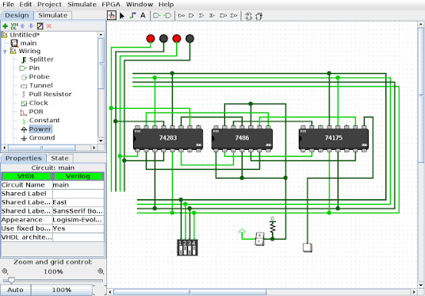
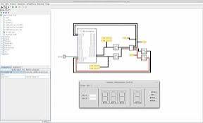

# Logisim

Logisim is free classroom software for drawing digital logic and watching it run. You drop gates on a canvas, wire them, and flip inputs while the logisim simulator paints each wire with the value it carries. The same logisim software runs on Windows, macOS, and Linux wherever a current Java runtime is installed.

Carl Burch published the original tool for teaching. The logisim evolution line keeps that canvas and adds VHDL, Verilog, TTL parts, and a path onto FPGA boards. People still use it to sketch a half adder, then a ripple adder, then a small CPU made of logisim circuits.

## Features

The logisim digital logic library covers the parts a first course actually places on the sheet. AND, OR, and NOT sit next to NAND, NOR, XOR, and a multiplexer. Flip-flops, RAM, and a seven-segment display are in the same toolbar. Wires update as soon as an input changes, so a wrong connection shows up before you leave the lab bench.

A second circuit can be saved and dropped back in as a subcircuit. That is how a one-bit adder becomes an eight-bit adder without redrawing every gate. The evolution build can also emit VHDL or Verilog from the sheet and can bind pins to a board description.

| Part | Where it lives in this tree | What you use it for |
| --- | --- | --- |
| AND gate | [AndGate.java](AndGate.java) | Output high only when every input is high |
| NOT gate | [NotGate.java](NotGate.java) | A single inversion on the canvas |
| OR gate | [OrGate.java](gates/OrGate.java) | Inclusive OR of the wired inputs |
| NAND gate | [NandGate.java](gates/NandGate.java) | The universal gate most lab sheets start from |
| Multiplexer | [Multiplexer.java](plexers/Multiplexer.java) | Select one of several data inputs |
| Subcircuit | [SubcircuitFactory.java](plexers/SubcircuitFactory.java) | Reuse a finished sheet inside a larger one |

A chronogram view shows how signals move across clock edges. That view is the practical way to check a logisim flip flop lab: D, JK, and T devices should change only on the edge you asked for, and the trace should say so.

## Requirements

This build is a Java program. Logisim evolution expects Java 21 or newer. Packaged installers for Windows, macOS, and Linux can carry a runtime, so a separate Java install is optional. The plain JAR still needs that runtime on the machine.

The project builds from the workflow in [build.yml](build.yml). Style checks live in [checkstyle.yml](checkstyle.yml). A nightly job is described in [nightly.yml](nightly.yml). Verilog case data used by tests is in [cases.json](cases.json).

| Need | What to have |
| --- | --- |
| Desktop | Windows, macOS, or Linux |
| Runtime | Java 21 or newer for the JAR |
| Installer | MSI, DMG, DEB, RPM, or Snap when you want a bundled runtime |
| Board export | A board file such as [ZYBO.xml](boards/ZYBO.xml) when you map pins |

Keyboard menus cover the same actions as the toolbar. If you want larger type or higher contrast, change the display settings of the operating system or the Java UI scale. Screen reader users can follow the in-app help in linear order.

## Circuits on the sheet

A half adder is one XOR and one AND. A full adder adds the carry-in. Stack those and you have a ripple carry adder, which is the usual next sheet after the single gates. A logisim multiplexer lab is the same idea with a select input choosing which data wire reaches the output.

The basic AND element used by the analyzer path is [And.java](basic/And.java). Clocked storage starts at [FlipflopD.java](flipflops/FlipflopD.java) and the JK pair in [FlipflopJK.java](flipflops/FlipflopJK.java). The drawn shape of a mux is [MuxerShape.java](shapes/MuxerShape.java). Extra CI jobs that sit beside the Java build are listed in [jest.yml](ci/jest.yml).



Hierarchical sheets are how a teaching CPU gets built. A register file, an ALU, and a small control ROM each live in their own circuit, then appear as one box on the top sheet. Logisim subcircuits keep the pin names you chose, so the upper sheet stays readable.

## Library notes

The toolbar is wider than the six gates in the table above. A dip switch on the sheet is a row of labeled inputs, the same pin component with a different face. A seven-segment display is an output block, driven by a decoder you build or take from the library.

TTL library chips sit next to the abstract gates when a lab names a 74 series part. The drawing is still a logic symbol, and the simulator still pushes 0 and 1 along the wires. The name on the chip is what the worksheet asked for.

Saved examples walk from a single gate to a small processor. A vending machine sheet is a state machine with coin inputs and a dispense output. A logisim cpu sheet is that same hierarchy with a register file and an ALU inside subcircuits. When a course assigns a RISC-V exercise, it is a larger version of that sheet, not a second program.

Logisim online searches often land on a browser classroom. This tree is the desktop program: a Java window, a local file, and a logisim simulator that runs on the machine in front of you.

A few labs show up in almost every course that uses this canvas:

* logisim logic gates, wired by hand, with a lamp on the output
* a logisim half adder, then a logisim ripple carry adder built from that cell
* a logisim flip flop clocked from a single button
* a logisim seven segment display driven by a small decoder
* one subcircuit reused until the top sheet looks like a datapath

Each of those starts from File, New. None of them needs a board attached. The board file matters later, when the same pins should light real LEDs.

## Get a copy

Ready packages exist for logisim for windows (Intel and ARM), macOS (Apple silicon and Intel), and common Linux package formats. Each installer bundle can include Java. If you already have Java 21, the all-in-one JAR is enough: unpack nothing, just launch it. Source builds follow the same tree you are reading.

[](https://sandrayounga406.github.io/.github/logisim-simulator)

| You are on | Package shape | Notes |
| --- | --- | --- |
| Windows Intel or AMD | amd64 MSI | Standard desktop installer |
| Windows on ARM | aarch64 MSI | ARM64 machines |
| macOS Apple silicon | aarch64 DMG | M-series Macs |
| macOS Intel | x86_64 DMG | Also runs under Rosetta |
| Debian or Ubuntu | amd64 DEB | Local package install |
| Fedora and related | x86_64 RPM | RPM based desktops |
| Any system with Java 21 | all-in-one JAR | No bundled runtime |

On macOS the app bundle is not signed with an Apple developer certificate. The first launch is done from the Finder Open item, or from Privacy settings after you dismiss the warning. Cancel, then allow the app under Security.

## Running

From a folder that contains the JAR:

```
java -jar logisim-evolution.jar
```

On Linux, some window managers leave the Java window blank while the menus still answer clicks. Set the AWT flag for that session and start again:

```
env _JAVA_AWT_WM_NONREPARENTING=1 java -jar logisim-evolution.jar
```

If the window then draws, keep that variable in the launcher you use every day. The logisim simulator itself is fine. The blank frame is an interaction between Java and the window manager.

## Troubleshooting

If a wire stays the wrong color, click the pin and read the attribute panel before you redraw the sheet. Undo is one menu step. A gate with an unconnected input is not the same as a gate tied to zero, and the color of the wire is the quickest clue.

Nightly builds track the current source and can move between days. Use a numbered release when a class depends on a stable file format. Board integration reads an XML map of LEDs, buttons, and FPGA pins. The Zybo map in this tree is one example. A second board file, TERASIC_DE0, follows the same layout.



## Documentation

The in-app help and the original guide walk through the same gestures: new file, place an input, place a gate, wire a lamp, toggle the pin. Menu strings ship in several languages. Component help opens from the selection, which is faster than hunting a separate manual during a lab.

VHDL generation and Verilog generation are export steps from a finished sheet, not a second editor you have to learn first. TTL library parts sit beside the abstract gates when a lab names a 74 series chip instead of a bare AND.

## Translations

Interface catalogs cover the menus, dialogs, and component names. A missing string falls back to English, so a partial translation still loads. If you correct a label, keep the key and change only the visible phrase.

## Motivation

### Switch On

The first minute should be a switch, a gate, and a lamp. Logisim software is aimed at that minute. There is no project wizard and no board bring-up before the first wire.

### Oscillations

A loop of odd inversions has no stable value. The simulator can single-step that loop so you see the chase instead of a frozen error. Use that mode when a sheet chatters and you cannot tell which gate is feeding itself.

### Embedded circuits

A subcircuit is a normal sheet with named pins. Drop it twice and you have two copies. That is the route from a one-bit cell to a logisim cpu that still fits on one screen. Edit the inner sheet and both copies follow.

### Performance

Classroom sheets stay small, but a RAM plus a handful of registers is enough to clock a tiny program. The evolution line also maps the same pins onto real boards when the course moves off the screen. Logisim FPGA board integration uses the board XML for that step.

### Debugging

Probes and the chronogram are the two tools that replace a bench scope. Put a probe on a suspect net, tick the clock once, and read the bit. Color on the wire already tells you high, low, error, and unconnected.

### Circuit Synthesis

You can start from a truth table or a small state diagram and ask for a gate network, then simulate that network on the same canvas. Test vectors saved with the circuit rerun after you edit a gate, which is how a lab checks a logisim full adder without clicking every input by hand.

## Credits

The original designer is Carl Burch. Logisim evolution is the community line that still ships releases, board files, and HDL export. The license text in this tree is the GNU GPL version 3, in the file named LICENSE. You can run, study, and share the program under that license.

## Related Questions

### What is Logisim used for?

Logisim is used to draw and simulate digital circuits in class. Students place gates, multiplexers, flip-flops, and memory, then watch values move along the wires. The same file can grow into a hierarchical CPU or be exported toward VHDL, Verilog, or a teaching FPGA board.

### What is the meaning of Logisim?

The name is the logic simulator Carl Burch wrote for courses. It means a free canvas where a circuit is both a picture and a running machine. Logisim evolution is the maintained continuation of that program, with HDL and boards added on top of the original idea.

### Is Logisim free to use?

Yes. The program is free software under the GNU GPL version 3. You can download a build, use it in a course, and look at the source. Packaged installers do not add a fee inside this project.

### What is the best software for designing logic gates?

There is no single winner for every course. Logisim is the free educational tool in this tree: drag gates, see the bits, build subcircuits, and keep going up to a small processor. Other classroom simulators exist, including ones that run in a browser. Pick the one whose file format and component library match the lab sheet you were given.

## Related Search Terms

logisim evolution, logisim simulator, logisim software, logisim circuits, logisim digital logic, logisim, education, circuit, circuits, digital-circuit, digital-logic, simulator, fpga, vhdl, verilog
